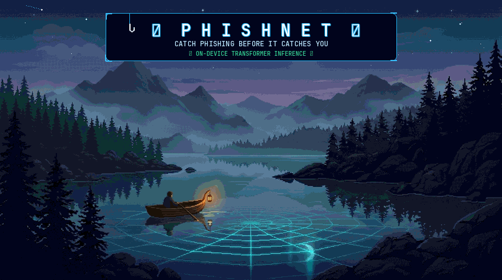
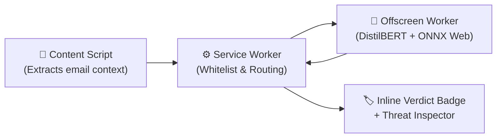

 

**On-device AI email security for Gmail and Outlook.**  
Powered by local DistilBERT & ONNX Web Runtime — no cloud uploads, zero telemetry.

[Website](https://anubhavaanand.github.io/code-cyan-phishNet/) · [Install](#-quick-install) · [Architecture](#-how-it-works) · [Privacy](PRIVACY_POLICY.md) · [Report Bug](https://github.com/anubhavaanand/code-cyan-phishNet/issues)

---

### 🛡️ Why PhishNet?

| Typical Cloud Scanners | 🎣 PhishNet |
| --- | --- |
| ☁️ Emails sent to third-party APIs | 🔒 **100% On-Device Inference** (Text never leaves your tab) |
| 📋 Static blocklists that quickly go stale | 🧠 **Local DistilBERT + Heuristic Engines** (~200ms per scan) |
| 💰 Costly enterprise subscriptions | 🆓 **Free & Open Source** (MIT) |

---

### ✨ Features

* **🛡️ Inline Verdict Badges** — Instant `Safe`, `Phishing`, or `Uncertain` status right beside the sender.
* **🔍 Threat Inspector** — Deep forensics: domain trust, urgency scoring, and attachment risk (`.pdf.exe`).
* **🔗 Spoofed Link Detection** — Detects Cyrillic homographs, punycode, and Levenshtein typosquatting across 25+ major brands.
* **⭐ Trusted Whitelist** — Instant pass-through for verified contacts and domains.
* **🌙 Dark-Mode UI** — Native glassmorphic styling matching Gmail and Outlook dark themes.

---

### ⚡ Quick Install

1. **Download & Extract** the latest [release ZIP](https://github.com/anubhavaanand/code-cyan-phishNet/archive/refs/heads/main.zip) (or `git clone https://github.com/anubhavaanand/code-cyan-phishNet.git`).
2. Go to `chrome://extensions` and enable **Developer mode** (top-right toggle).
3. Click **Load unpacked** and select the folder.

> 💡 *The ~50 MB quantized model downloads once on your first scan and is cached in the browser afterwards. Clearing your browsing data removes it — the next scan downloads it again.*

---

### 🧠 How It Works

* **Classifier**: Quantized int8 [`distilbert_v2.4.1`](https://huggingface.co/cybersectony/phishing-email-detection-distilbert-v2.4.1) running in an isolated offscreen document via Transformers.js v3.
* **Fallback Safety**: If WebAssembly or the model fails to load, rule-based heuristics seamlessly take over.

---

### 📊 Tech Specs & Performance

| Category | Specification |
| --- | --- |
| **Inference Time** | ~200 ms (DistilBERT) · ~0.25 ms (Heuristic Fallback) |
| **Extension Footprint** | ~70 KB core code · 100% idle memory coalesced |
| **Compatibility** | Desktop Chromium (Gmail, Outlook.com, Office 365 OWA) |
| **Testing** | 213 tests (`npm test`) — `node --test` for the extension core, Vitest for the React UI — plus GitHub Actions CI |

---

### ❓ FAQ

<b>Does my email ever leave my computer?</b>

Never. Inference happens completely inside your browser tab via client-side WebAssembly. No analytics, tracking, or telemetry exist.

<b>Why is the first scan slightly slower?</b>

The extension fetches the quantized ~50 MB model weights once from Hugging Face's CDN and caches them in your browser. All subsequent scans run offline in ~200ms.

<b>How do I handle false positives?</b>

Click the verdict badge to inspect which heuristic or model signal fired, then click ⭐ to whitelist the sender.

---

### 🤝 Contributing

**New here? Start with the [Newcomer Guide](NEWCOMER_GUIDE.md)** — local setup, the checks CI runs, good-first-issue entry points, and your first PR, step by step. Full details live in [CONTRIBUTING.md](CONTRIBUTING.md).

The flow is a standard fork-and-pull-request, with one addition: **claim the issue before you start**. Comment `/assign-me` on an open issue and the bot labels it yours and gives you 7 days to open the PR. Comment `/release` to hand it back. Up to 3 claims at a time.

---

MIT Licensed · Built with 🎣 by <a href="https://github.com/anubhavaanand">Anubhav Anand</a>

